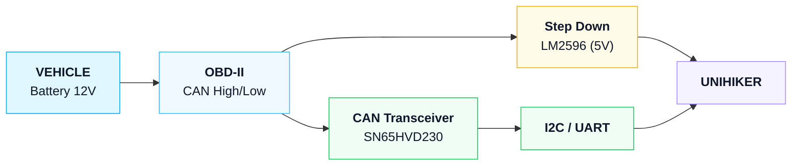

# Unihiker Automotive Project

## Overview
Embedded automotive system for real-time OBD-II data reading and display. The system collects vehicle telemetry through the diagnostic port and shows it on the Unihiker K10 display.

## Project Goal
- Read vehicle telemetry via OBD-II/CAN.
- Show diagnostics on a graphical interface on the Unihiker K10.
- Provide a indications to drivers based on the data.

## System Architecture
- Main controller: Unihiker K10.
- Dual-core structure: one core for data reading, one for screen rendering.
- CAN acquisition: SN65HVD230 module connected to OBD-II.
- Power supply: LM2596 regulates 12V battery voltage to 5V.

## Functional Flow
### Hardware Flow
1. Vehicle 12V enters through the OBD-II extension cable.
2. OBD-II provides power and CAN data to the SN65HVD230 transceiver.
3. The SN65HVD230 converts differential CAN signals to logic levels.
4. The Unihiker K10 receives data via I2C/UART and processes it.
5. The LM2596 regulates 12V down to 5V for the Unihiker.

### Software Flow
1. Initialize the CAN module and OBD-II interface.
2. Read the relevant PIDs:
   - Engine RPM
   - Temperature
   - Pressure (turbo/oil)
   - MAF (Mass Air Flow)
   - Battery voltage
3. Convert raw CAN frames into readable values.
4. Render the GUI on the Unihiker display.

## User Interface
The interface should display:
- Diagnostic values in a friendly form.
- Clear alerts based on the data.

## Project Components
- **Unihiker K10**: main processing unit with 2.8" color display, Rockchip RK3308 processor, and internal ESP32-C3 for hardware management.
- **SN65HVD230 CAN module**: converts CAN differential signals to TTL logic.
- **I2C/UART cable**: serial communication between CAN module and Unihiker.
- **OBD-II extension cable**: connects to the vehicle diagnostic port for CAN data and 12V power.
- **LM2596 adjustable regulator**: buck converter that drops 12V to stable 5V.
- **Hikari multimeter**: used to calibrate the regulator and verify voltage stability.

## Usage
1. Connect the OBD-II extension cable to the vehicle diagnostic port.
2. Set the LM2596 output to 5V using a multimeter.
3. Connect the SN65HVD230 to the OBD-II CAN bus.
4. Power on the Unihiker K10 and start the CAN reader software.
5. Confirm the selected PIDs are being read and displayed correctly.
