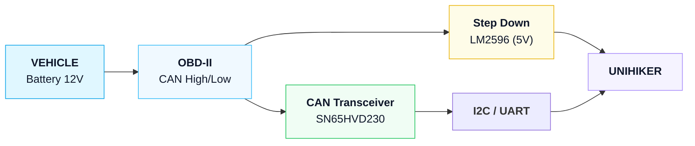

# Unihiker Automotive Project

## Overview
Embedded automotive system for real-time OBD-II data reading and display. The system collects vehicle telemetry through the diagnostic port and shows it on the Unihiker K10 display.

## Project Goal
- Read vehicle telemetry via OBD-II/CAN.
- Show diagnostics on a graphical interface on the Unihiker K10.
- Provide a indications to drivers based on the data.

## System Architecture
- Main controller: Unihiker K10.
- Dual-core structure: one core for data reading, one for screen rendering.
- CAN acquisition: SN65HVD230 transceiver connected directly to the ESP32-S3 TWAI controller.
- Power supply: LM2596 regulates 12V battery voltage to 5V.

## Functional Flow
### Hardware Flow
1. Vehicle 12V enters through the OBD-II extension cable.
2. OBD-II provides power and CAN data to the SN65HVD230 transceiver.
3. The SN65HVD230 converts differential CAN signals to TTL logic levels.
4. The Unihiker K10 (ESP32-S3 co-processor) receives data directly through GPIO 1 (TX) and GPIO 2 (RX).
5. The LM2596 regulates 12V down to 5V for the Unihiker.

### Software Flow
1. Initialize the CAN module and OBD-II interface.
2. Read the relevant PIDs:
   - Engine RPM
   - Temperature
   - Pressure (turbo/oil)
   - MAF (Mass Air Flow)
   - Battery voltage
3. Convert raw CAN frames into readable values.
4. Render the GUI on the Unihiker display.

## User Interface
The interface should display:
- Diagnostic values in a friendly form.
- Clear alerts based on the data.
The system features 7 customizable screens (IDs 0 to 6) designed with LVGL:
- **Screen 6 (Introductory / Idle Screen):** The default startup and rest screen displaying "Unihiker Automotive Project" with a minimalist, programmatically-drawn vector car in the center. Instructs the user to press Button A to transition to the live telemetry dashboards.
- **Screen 0 (Sport Dashboard):** Dual analog gauges showing RPM (0-7000) and Speed (0-200 km/h). Features an adaptive Shift Light bar (turns on medium brightness at 4000 RPM, full brightness at 5500 RPM) and a central Boost pressure arc (0.0 to 1.5 Bar).
- **Screen 1 (Oil Temperature):** Clean vertical bar indicator showing oil temperature (50-120 °C) with a custom vector-drawn oil can icon. Automatically turns red if temperature reaches or exceeds 120 °C.
- **Screen 2 (BMW Style):** Classic amber/red glow instrument cluster showing analog Boost pressure (0-1.5 Bar) and Oil Temperature (50-150 °C).
- **Screen 3 (Central Turbo):** Prominent central Boost pressure gauge (0-1.5 Bar) with an integrated digital display, paired with a subtle, masked lower gauge for Oil Temperature.
- **Screen 4 (Peugeot Style):** Circular sport style Boost pressure indicator with a red outer ring and elegant white pointer.
- **Screen 5 (Diagnostics Panel):** Technical screen showing:
  - **Battery System:** Live voltage reading (10.0V - 15.0V) and charging status (*LOW VOLTAGE* in red if < 11.8V, *CHARGING OK* in green if >= 13.5V, or *SYSTEM OK* in amber).
  - **Air Flow (MAF):** Circular gauge visualizing engine air flow in g/s (0-250 g/s).
  - **ECU Status LED:** Real-time visual connection status (Green = Connected / ECU active, Red = Offline).

## Project Components
- **Unihiker K10**: main processing unit with 2.8" color display,  Xtensa® LX7 dual-core processor, and internal ESP32-S3 co-processor for screen and peripheral control.
- **SN65HVD230 CAN Transceiver**: converts CAN differential signals (CANH/CANL) to ESP32-compatible TTL logic levels.
- **Direct GPIO Connection**: directly wired to GPIO 1 (TX) and GPIO 2 (RX) on the Unihiker to communicate with the internal TWAI controller.
- **OBD-II extension cable**: connects to the vehicle diagnostic port for CAN data and 12V power.
- **LM2596 adjustable regulator**: buck converter that drops 12V to stable 5V.
- **Hikari multimeter**: used to calibrate the regulator and verify voltage stability.

## Usage
1. Connect the OBD-II extension cable to the vehicle diagnostic port.
2. Set the LM2596 output to 5V using a multimeter.
3. Connect the SN65HVD230 to the OBD-II CAN bus.
4. Power on the Unihiker K10 and start the CAN reader software.
5. Confirm the selected PIDs are being read and displayed correctly.
